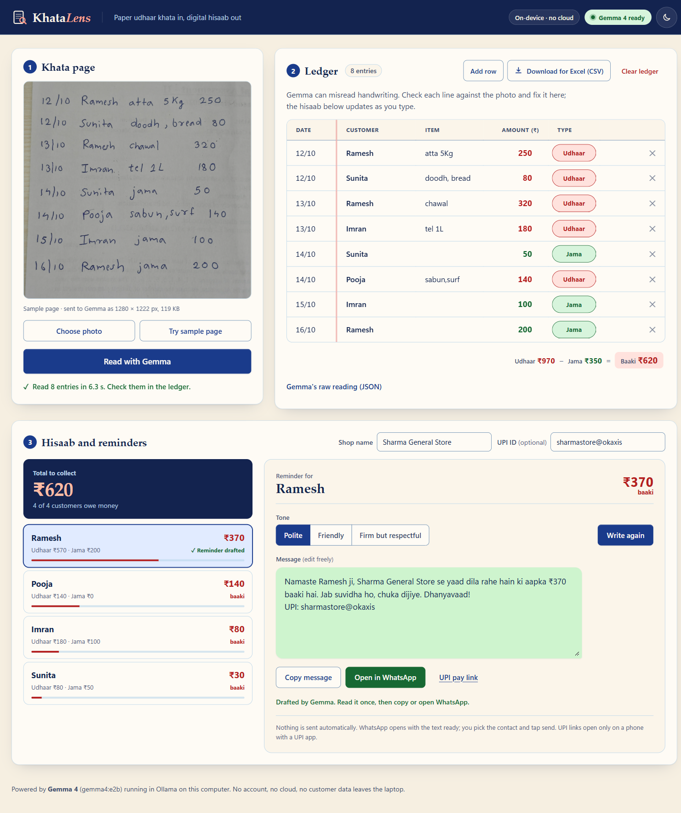
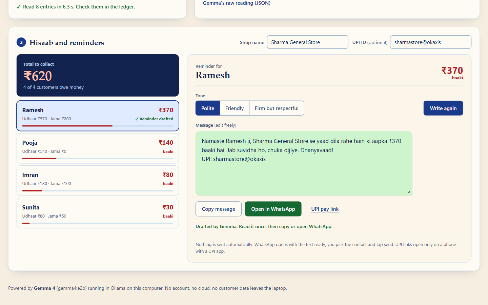
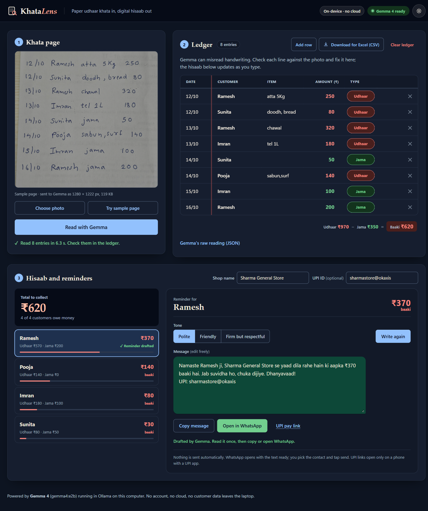

# KhataLens

Photograph a page of a handwritten udhaar khata. Gemma 4 reads it on your laptop, turns it into
an editable ledger, totals what each customer owes, and drafts a polite Hinglish payment reminder
you can copy or open in WhatsApp. Nothing is sent automatically and nothing leaves the laptop.

Built for **Best Use of Gemma 4** at Hacktoberfest 2026 Mumbai.



## The problem

Small shops across India run on credit. A regular customer takes atta today and pays at the end
of the week, and the shopkeeper writes it in a paper udhaar notebook: date, name, item, amount,
and "jama" when money comes back. Working out who owes how much means re-adding pages of
handwriting, and asking for money is awkward, so dues slip.

Existing ledger apps expect the shopkeeper to retype everything. KhataLens starts from the
notebook he already keeps.

## What it does

1. **Photos in.** Take or drop one photo per page (several at once for a whole book), or press
   "Try sample page". Pages are read one after another, every row is tagged with its page
   (P1, P2...), and the same customer on different pages adds up into one balance. Re-adding a
   photo that is already in the ledger asks before counting it twice.
2. **Gemma reads it.** Gemma 4's vision model turns each handwritten line into a structured entry:
   customer, item, date, amount, and whether it's udhaar (credit given) or jama (payment received).
3. **You check it.** The ledger sits next to the photo. Fix any misread; corrected rows are tagged
   and balances update as you type.
4. **Hisaab.** Customers are grouped by name (trimmed, case-insensitive) and sorted by amount owed.
   Balance = udhaar − jama. The total to collect is always visible.
5. **Reminders.** Pick a customer and a tone (polite, friendly, firm but respectful). Gemma writes a
   short, respectful Hinglish message with the name, the ₹ amount, the shop name and, if set, your
   UPI ID. Edit it, then **Copy** or **Open in WhatsApp**; you choose the contact and tap send.
6. **Export.** Download the ledger and per-customer balances as a CSV that opens in Excel.



## How Gemma 4 is used

KhataLens uses one local model, `gemma4:e2b` (about 4.6B parameters, Q4_K_M), through Ollama's
`/api/chat`, for two jobs:

| Job | Input | How |
|---|---|---|
| Read the page | Photo, downscaled in the browser to 1280 px JPEG | Vision call with a **JSON schema in `format`** (structured output), `think: false`, temperature 0.1. The system prompt explains khata conventions: a name with an amount is udhaar unless the line says jama / paid / diya / received; read numbers literally; never invent rows; uncertain fields become `null`. The app then applies the khata rule per line in code: a payment word (jama, paid, diya...) means jama, and a real item means udhaar. |
| Write a reminder | Customer, balance, shop name, tone | Text-only call returning plain Roman-script Hinglish, at most 60 words, no threats or shaming. The app checks the reply contains the name, amount and shop, retries once, and falls back to a fixed template if needed. The UPI line is added by the app, not the model, so it is always exact. |

Reliability details:

- The model is warmed up when the app opens, and the status pill shows "Gemma loading" or "Gemma 4 ready".
- 120 s timeout. Invalid JSON is retried once; after that Gemma's raw answer is shown instead of a blank error.
- On the sample page, Gemma read all 8 lines correctly (names, amounts, dates, udhaar/jama), in
  about 6–8 s per page once the model was loaded on our laptop. The first call after starting
  Ollama takes longer while the model loads.

### Why on-device matters here

A credit ledger is personal financial data about the shop's neighbours: who bought what, who
hasn't paid. Running Gemma 4 locally means the photo, the names and the amounts never go to a
cloud API, there's no account to create, no per-call cost, and it keeps working on a patchy shop
connection. A small multimodal model that fits on an ordinary laptop is what makes that possible.

## Run it

Requirements: [Ollama](https://ollama.com) and Node.js 22.12 or newer.

```powershell
# 1. Get the model (one time) and make sure Ollama is running
ollama pull gemma4:e2b
ollama serve          # skip if the Ollama app is already running

# 2. Install and start the app
npm install
npm run dev
```

Open the URL Vite prints (usually http://localhost:5173), press **Try sample page**, then
**Read with Gemma**.

Other scripts: `npm run build` (type-check and production build), `npm run preview`.

The browser talks to Ollama through Vite's dev proxy (`/ollama` → `http://localhost:11434`),
so there is no CORS setup and no API key.

## Security and privacy

- No backend, no accounts, no secrets. The ledger and settings live in the browser's `localStorage`.
- All model output is inserted with `textContent` / form values, never as HTML.
- CSV export guards against spreadsheet formula injection (cells starting with `=`, `+`, `-`, `@`
  are written as text).
- **Do not expose port 11434** (Ollama) or the dev server to the internet. Both are meant for
  `localhost` only and have no authentication.
- The sample page uses made-up names.

## Tech

- Gemma 4 (`gemma4:e2b`) via Ollama 0.40
- Vite 8.3.4, TypeScript 6.0.3, vanilla DOM, no runtime dependencies
- Plain HTML and CSS with OKLCH colour tokens, light and dark themes

```
src/
  gemma.ts       Ollama calls: extraction (schema), reminders, warm-up
  image.ts       Downscale to 1280 px JPEG, base64
  pages.ts       Which photos are already read (SHA-256 fingerprints only)
  ledger.ts      Entries, balances, localStorage
  ledgerView.ts  Editable ledger table
  reminders.ts   Hisaab list + reminder composer
  csv.ts         Excel-friendly CSV export
  settings.ts    Shop name, UPI ID, upi:// link
  main.ts        Wiring and UI states
```



## Future work

- **WhatsApp Business API auto-send**, with the shopkeeper's approval per message, instead of
  copy and open.
- **Devanagari and Marathi notebooks.** Today the prompt and the sample target Roman-script
  Hinglish entries with English numerals.
- **Smarter multi-page books.** Spot the same line photographed twice from different angles,
  and match name spellings across pages ("Ramesh" vs "Rameshbhai").
- **Voice entry.** "Ramesh, atta paanch kilo, do sau pachaas" straight into the ledger.
- Partial payments linked to specific udhaar lines, and reminder history per customer.
